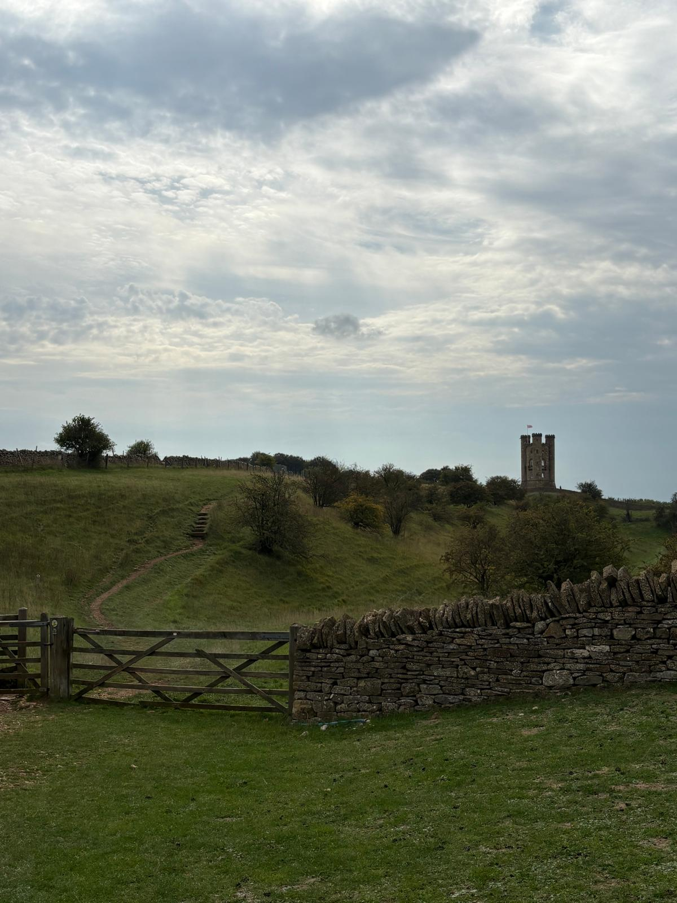
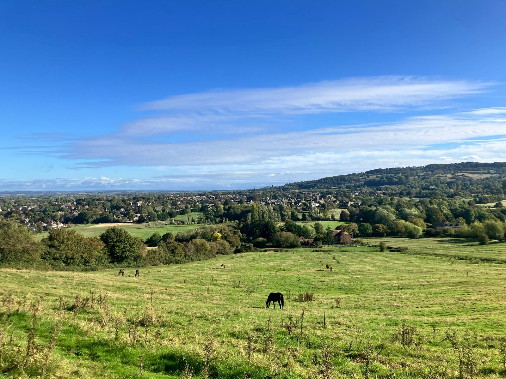
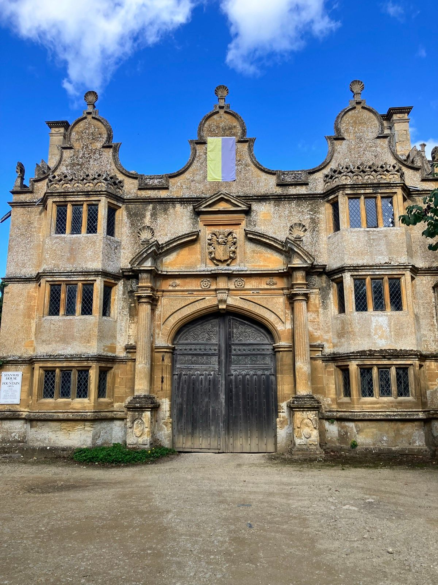

One week, 82 miles, great food, and lots of conversation

## Day #1:
6.0 mi

Shorter hike from Chipping Camden to Broadway. Pleasant weather and beautiful views near Broadway tower. 
<figure>
  
  <figcaption>Broadway Tower</figcaption>
</figure>
<figure>
  
  <figcaption>View from Day 1</figcaption>
</figure>
## Day #2:
12.8 mi

Decent hike from Broadway to Winchcombe. Pleasant weather again. We saw the Stanway House & Gardens, a beautiful Jacobean manor, though were only able to see the frontside.
<figure>
  
  <figcaption>Stanway House and Gardens</figcaption>
</figure>
## Day #3:
12.7 mi

Winchcombe to Cheltenham. Good weather, though it was quite windy. At the top of Cleeve hill was an ancient burial structure called Belas Knap (see image below).

## Day #4:
7.7 mi

We had to skip a section in the middle if we were to make it all the way to Bath, so we took the bus to Gloucester, saw the Cathedral, which was quite impressive, and had lunch there. We then took the bus from Gloucester to Selsley, and backtracked a little so that we could get a bit of hiking in. On the route back, we went through Stroud, a former industrial town with a long canal running through it. I thought it would be cool to open one of the locks, though I'm not sure that was allowed. Of note: the hostel on day 4 was by far the best. Excellent accommodation, friendly staff, and a great dinner. 

## Day #5:
14.0 mi

Stroud to Wotton-under-Edge. Back to the normal(ish) length, though we were certainly exhausted by the end of the day as there was a very steep hill we had to trudge up before hiking into Dursley. 

## Day #6:
17.6 mi

Wotton-under-Edge to Tolldown. This was by far the longest day of the trip, and our stopping place, Tolldown was no more than a hotel and a few shops. I ended up soaking my legs in the bath at the end of the day, as they were quite sore from the hike.

## Day #7:
12.2 mi

Tolldown to Bath. The end of the trip! This was quite a fun day, because it was medium length, though the last 5 miles or so were only downhill, making it quite easy. Bath was nice, though we weren't able to stay there for long. 
